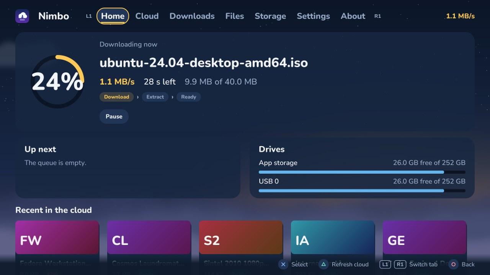
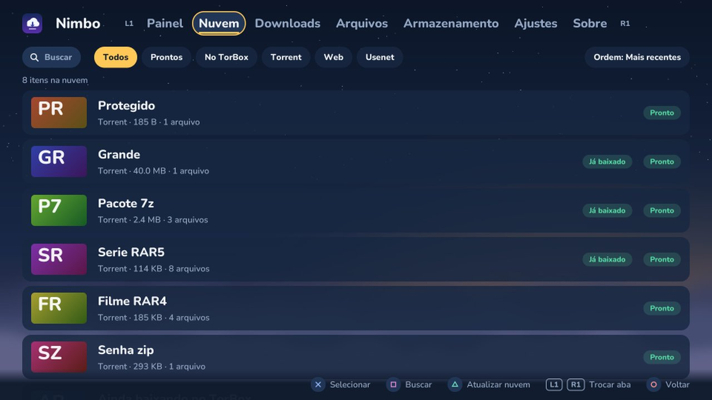
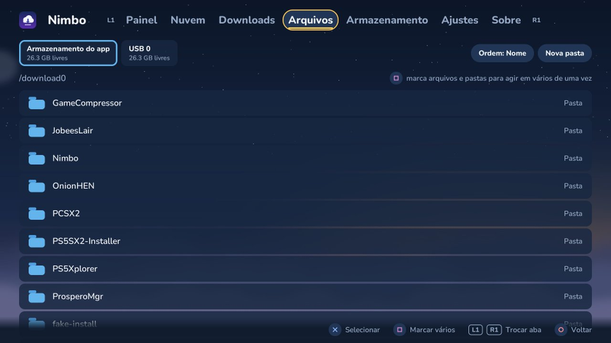
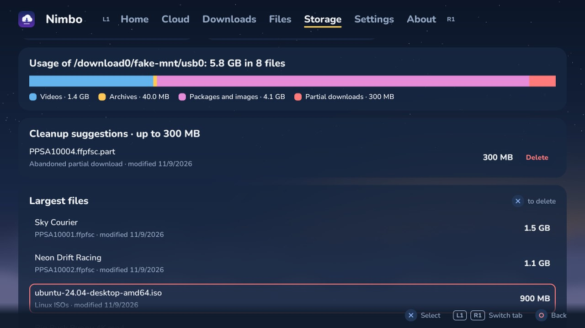
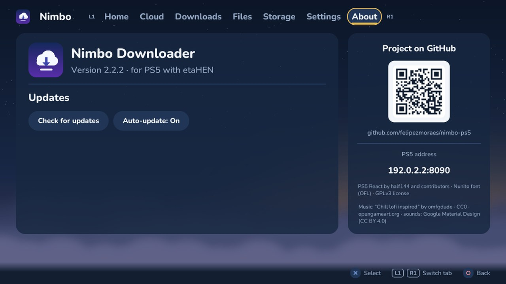

# Nimbo Downloader for PS5

**English** · [Português (Brasil)](README.pt-BR.md)

A native app for jailbroken PS5 consoles that downloads from your cloud (**TorBox, Real-Debrid, AllDebrid and Premiumize**) straight to the internal SSD, USB or extended storage. It extracts archives, organizes your downloads and shows what is taking up space. Use it with the controller on the TV, or from your phone.



## What it does

| | |
|---|---|
| **Cloud** | Combines TorBox, Real-Debrid, AllDebrid and Premiumize in a single list, with search (including file names inside each item), per-service filters and sorting. Each item shows its content type and how it reached the service (e.g. "Game · via Web"). Downloads only the files you mark and can delete them from the cloud afterwards. The list loads more items by itself when you reach the end, with no "Show more" button. |
| **QR code login** | TorBox, Real-Debrid and AllDebrid connect by pointing your phone at the TV. Premiumize uses its API key, typed on the PS5 or pasted from your phone. |
| **Downloads** | Multiple connections per file, resume, a saved queue, speed limit, a home panel showing the steps (download › extract › done) with the current one highlighted and "download when ready" for items still being prepared in the cloud. Cancelling deletes the partial file and the folder it left empty. The home panel highlights the next item ready in the cloud (one press on Download starts it), numbers the queue, flags failures and warns when the queue won't fit on the drive. Covers show the release's clean title, its type (game, series, movie, archive, music) and tags such as game ID, version, season and resolution. |
| **Extraction** | ZIP (including password-protected), 7z, RAR and RAR5, also split into parts. Can extract when a download finishes, delete the archive afterwards and take files out of subfolders (all loose in the chosen folder). Saved archive passwords can be added, edited and deleted. |
| **Files** | Browse the SSD, USB and extended storage. The **Select** button (or □) marks several files and folders to copy, move, delete, rename and extract. Shows the game name next to files like `PPSA07784.ffpfsc`, the date of each file, drawn icons by type, sorting and a type filter (folders, videos, archives, packages, audio, images). With items marked, Triangle opens the actions (move, copy, delete, take files out of folders) from anywhere in the list. |
| **Storage** | Usage by type, largest folders and files (with game name and date), cleanup suggestions and, for each installed game, version, install date and the size of the game, its updates and DLCs. Deleting runs in the background without freezing the screen. |
| **Phone** | A PIN-protected page on the same network to see the queue, paste links (magnet, file hosts, direct) into any connected service and download from the cloud. Tabs sit at the bottom, within thumb reach, and the active download is shown first. |
| **Languages** | Português (Brasil), English, Español, Français, Deutsch and Italiano, including the phone page. Follows the PS5 language on first launch. |
| **Auto-update** | Checks this repository's Releases every 6 hours and installs new versions by itself when no downloads are running. Tells you when a new version is out (a banner at the top and a PS5 notification), shows progress while it installs and shows what changed in **About › What's new**. |
| **Backup of your settings** | Logins, settings and the queue are also saved to `/data/nimbo-settings`, so they come back if you delete the app from the PS5 menu and reinstall it. |
| **Controller light** | Shows the queue state: amber while downloading, purple while extracting or copying, green when done and red if something fails. |
| **Ambience** | Lo-fi music (CC0) and interface sounds, with volume control and an off switch. Translucent panels over a cloudy sky, and custom art on the PS5 home screen. |

<p>
 
 
</p>

## Requirements

- A jailbroken PS5 with **etaHEN** and **ShadowMount+**. Tested on firmware 12.40.
- An account with at least one service (TorBox, Real-Debrid, AllDebrid or Premiumize), only for the Cloud tab. Files, Storage and direct links work without an account.

## Install

1. Download `NimboDownloader-PS5-vX.Y.Z.zip` from [Releases](../../releases).
2. Copy the whole `PPSA48921` folder to `/data/homebrew/` on the PS5. The easiest way is etaHEN's FTP server (port 1337), using FileZilla or an FTP app on your phone.
3. Wait for ShadowMount+ to register the app: its icon shows up on the home screen. If it doesn't, restart the PS5 and run etaHEN again.
4. Open Nimbo and connect your service in **Settings › Cloud services**.

**Update:** automatic (turn it off in **About › Auto-update**). To force it: **About › Check for updates › Update**. Then close and reopen the app. To update manually, replace the `PPSA48921` folder over FTP; there's no need to delete the app from the PS5 menu.

> **Updating from 2.2.6 or older?** If you see "no such file or directory", close and reopen the app and update again. It happened when auto-update and the Update button ran at the same time; fixed in 2.2.7.

> **Coming from 2.2.2 or older?** Install 2.2.3 manually once: older versions look for updates at the repository's old address. From 2.2.3 on, auto-update works.

## Controls

| Button | Action |
|---|---|
| ✕ | Select |
| ○ | Back / close · folder up (Files) |
| △ | Refresh the cloud · filter or open selection actions (Files) · main action of the open window (Download, Use this folder, Add password) |
| □ | Search (Cloud) · select several (Files) · secondary action of the window (New folder, Mark all) |
| L1 / R1 | Switch tab |

The touchpad is turned off so it doesn't move the cursor by accident.

## Project layout

```
nimbo/            V2 app (PS5 React): index.jsx, src/, assets/, sce_sys/
  src/engine.js   download queue, extraction and copies
  src/torbox.js   TorBox API
  src/debrid/     Real-Debrid, AllDebrid, Premiumize and the common service interface
  src/i18n.js     languages (translations in src/i18n/strings.js, generated from tools/i18n.tsv)
  src/music.jsx   background music (assets/music: the CC0 track split into WAV segments)
  src/update.js   updates from GitHub
  src/phone.js    phone server and web page
tools/            art generators (make_art, make_keyart, make_dds) and i18n.py (translations)
src/, web/        V1 (ELF payload + browser interface)
docs/             readme files and screenshots
```

## Building

The app is built with **[PS5 React](https://github.com/JVK3R/ps5-react)** (React on QuickJS, native rendering at 1080p). On Windows, use WSL 2 with Ubuntu and clone the SDK inside Linux (`~/`), not under `/mnt/c`.

```bash
# inside PS5 React
CC=clang CXX=clang++ python3 tools/cli.py preview --app-dir /path/to/nimbo-ps5/nimbo   # preview on the PC
CC=clang CXX=clang++ python3 tools/cli.py build   --app-dir /path/to/nimbo-ps5/nimbo   # builds dist/PPSA48921
```

The art is generated by the scripts in `tools/`. The PS5 home screen uses `sce_sys/pic0.dds` (3840×2160, BC7), created by `tools/make_dds.py`.

**Translations:** edit `tools/i18n.tsv` (the Portuguese text is the key) and run `python3 tools/i18n.py build`. It generates `nimbo/src/i18n/strings.js` and reports anything missing.

**Publishing a version:** change `APP_VERSION` in `nimbo/src/update.js` and `version` in `nimbo/app.json`, build, and create a Release tagged `vX.Y.Z` with the zip attached. The zip name must contain "PS5" and the `PPSA48921` folder must be inside it, because that's what the app looks for when updating.

## Version 1 (legacy)

The first version was an ELF payload (`nimbo-ps5.elf`) run by PS5 Payload Manager, with its interface opened in the PS5 web browser. The code is still in `src/` and `web/`. To build it: `./scripts/build-deps-ps5.sh && make ps5 && ./scripts/package.sh` (SDK in `/opt/ps5-payload-sdk`).

## Legal notice

Nimbo Downloader is a **download and file manager**. It does not provide, host, index or point to any content. It only transfers files that the user stored in their own account on a third-party service, or links the user entered.

- The app **was not made for piracy** or for circumventing copyright protection, and the author does not endorse such use. Its purpose is to download and organize content you have the right to use: your own backups, homebrew, free software, public-domain media or legally acquired content.
- **The user is solely responsible for what they download.** It is up to the user to follow the laws of their country and the terms of the services they use (TorBox, Real-Debrid, AllDebrid, Premiumize and others).
- Jailbreaking a console may violate the manufacturer's terms of use, void the warranty and put the device at risk. Do it at your own risk.
- This is a personal, independent project with **no affiliation** with Sony Interactive Entertainment, PlayStation, TorBox, Real-Debrid, AllDebrid, Premiumize or any service mentioned. Trademarks belong to their owners.
- The software is provided **"as is", without warranty**, under the GPLv3 license. The author is not liable for data loss, damage to the console or misuse.

The screenshots use free, open content (Blender open movies, Linux distributions, Creative Commons music) and made-up game names.

## Credits and licenses

Nimbo is GPLv3. Everything from third parties is licensed for use and redistribution and is listed in **[CREDITS.md](CREDITS.md)** (in Portuguese):

- **Music:** "Chill lofi inspired" by omfgdude ([OpenGameArt](https://opengameart.org/content/chill-lofi-inspired)), **CC0** (public domain: free to use, including commercially, no credit required).
- **Interface sounds:** Google Material Design sound resources, **CC BY 4.0** (credited in the app and in CREDITS.md).
- **Font:** Nunito, **SIL OFL 1.1**.
- **Framework:** PS5 React by half144 and contributors (now continued at https://github.com/JVK3R/ps5-react), GPLv3.
- **qrcode-generator** (MIT). V1 uses cJSON, curl, mbedTLS, libarchive, zlib and xz.

The credits also appear in the app's **About** tab.
